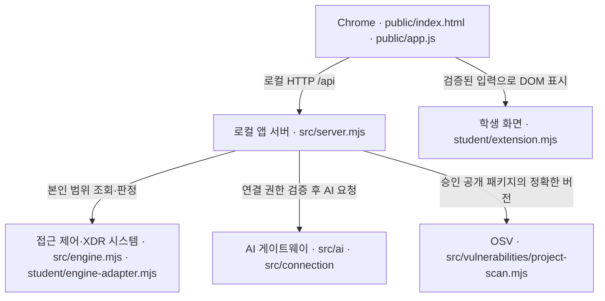

# 케셰브 학생 실행 설명서 · 21단계

## 목적과 확인 범위

케셰브는 직원 본인의 사용자·기기·세션, 업무 앱 접근 판정, 접속·XDR 기록을 표시하는 학습용 보안 Agent입니다. AI 설명은 기록의 근거와 규칙에 연결된 참고 정보입니다. 제안·사람 확인·서버 접수(ACK)·실제 효과 관측을 구분하며, OSV 조회는 정확한 설치 버전과 알려진 취약점의 대조 결과를 표시합니다.

이 문서는 저장소의 실제 파일을 읽어 작성했습니다. Windows에서 실행했다고 주장하지 않습니다. 앞 단계 학생 코드, 제공 README, 서버, 인증 및 설정은 변경하지 않았습니다. 이번 단계 변경은 이 학생 문서뿐이며 같은 커밋 스냅샷에 기존 13~20단계 구현이 포함됩니다.

| 항목 | 코드·기록에서 확인한 값 | 실제 실행 확인 |
|---|---|---|
| 시작 틀 | package.json의 alekov-client-starter 0.2.21 | 파일 확인 |
| Node.js 기준 | package.json engines.node = 24.19.0, 실행 도구는 22~24 허용·24.19.0 권장 | 현재 학생 Windows 버전 미확인 |
| 문법·모의 검사 환경 | 작성 보조 환경 Node.js v24.22.1 | 이 환경의 버전 명령 확인. 학생 Windows와 다름 |
| PowerShell | tools/start-alekov.ps1, Windows PowerShell 실행 경로 사용 | 학생 PC 버전 미확인 |
| Git | 실행에는 필수 아님. 변경 보존·커밋·원문 묶음에는 필요 | 학생 PC 현재 버전 미확인 |
| 브라우저 | 학생은 Chrome 사용. 로컬 HTTP 화면 | 현재 화면 재현 미확인 |
| 운영체제 | 제공 실행 도구는 Windows 전용 | macOS·Linux 실행 도구, 다른 브라우저 미검증 |
| 외부 npm 패키지 | 현재 package.json에 dependencies/devDependencies 없음 | 설치 불필요. node_modules 설치 상태 미확인 |
| 잠금 파일 | 저장소 최상위 package-lock.json 없음(파일 조회 404) | 조회 대상 프로젝트의 잠금 파일·설치 메타데이터 미확인 |

## 실제 폴더와 역할

이 GitHub 저장소는 package.json과 src/server.mjs가 최상위에 있는 **앱 폴더 자체**입니다. 제공 안내의 워크벤치 배치는 상위 프로젝트/on-client일 수 있으므로 Git 최상위와 앱 실행 위치를 혼동하지 않습니다.

| 저장소 기준 실제 경로 | 역할·작성 경계 |
|---|---|
| README.md | 제공 시작 안내. 보존 |
| package.json | start/demo/check/package-app 명령, Node.js 기준 |
| .env.example | 비밀 없는 설정 견본. 이 단계에서 변경하지 않음 |
| tools/start-alekov.ps1 | 제공 Windows 시작 도구·버전/포트 검사 |
| src/server.mjs | 제공 로컬 HTTP/API 서버 |
| src/engine.mjs | 연결 어댑터 로딩·예제 엔진·미연결 처리 |
| student/engine-adapter.mjs | 호스트가 허용한 본인 범위 기능을 전달하는 어댑터. 현재 파일 보존 |
| student/extension.mjs | 학생 DOM 표시 구현(createStudentView의 8개 함수) |
| public/index.html, public/app.js | 제공 화면·버튼·요청·검증·취소·응답 세대 관리 |
| public/vulnerabilities-view.mjs | 제공 OSV 응답 정규화·기본 표시 |
| src/vulnerabilities/project-scan.mjs | 설치 메타데이터 검증·승인 공개 패키지 조회 |
| docs/STUDENT_LAUNCH_GUIDE.md | 제공 시작·종료·오류 안내 |
| docs/STUDENT_RUNBOOK.md | 이 학생 실행 설명서·글 구성도 |

## 준비와 작업 보존

새 PowerShell 창을 엽니다. 앱 폴더는 파일 탐색기에서 package.json, src, student, tools가 함께 보이는 위치입니다. 그 위치의 주소 표시줄에 powershell을 입력하여 엽니다. 과거 작업 경로는 C:\Users\User\Downloads\alekov-stage13\on-client였으나 현재 PC에 남아 있는지는 미확인입니다. 없는 경로를 새로 만들지 말고 실제 파일 위치에서 시작합니다.

```powershell
Get-Location
Test-Path .\package.json
Test-Path .\src\server.mjs
Test-Path .\student\extension.mjs
Test-Path .\tools\start-alekov.ps1
node --version
$PSVersionTable.PSVersion
git --version
git rev-parse --show-toplevel
git status --short
git diff --stat
git diff --cached --stat
```

네 가지 Test-Path가 True여야 아래 실행 위치와 맞습니다. Node.js 출력은 기록하되 요구 버전과 실제 확인 버전을 구분합니다. Git 작업·스테이징 변경이 있으면 내용을 먼저 확인하고 보존합니다. 초기화·강제 덮어쓰기·정리 명령을 사용하지 않습니다. 위 명령은 현재 학생 PC에서 미실행입니다.

현재 저장소는 외부 npm 의존성이 없고 package-lock.json도 없으므로 npm install이나 npm ci를 시작 전 필수 절차로 넣지 않습니다. 취약점을 만들기 위해 패키지를 추가하거나 버전을 낮추지 않습니다.

## 시작·브라우저·정상 신호

앱 폴더 PowerShell에서 제공 시작 도구를 실행합니다.

```powershell
powershell -NoProfile -ExecutionPolicy Bypass -File .\tools\start-alekov.ps1
```

기본 브라우저 주소는 http://127.0.0.1:5189/ 입니다. 실행 도구는 시작 뒤 이 주소의 HTTP 200 응답을 확인하고 다음 메시지를 출력하도록 되어 있습니다.

- 케셰브가 켜졌습니다. 브라우저에서 http://127.0.0.1:5189/ 을 여세요.
- 서버가 응답한 것만 확인했습니다. AI 연결 상태는 화면에서 따로 확인해 주세요.

위 문구는 코드에서 확인한 **예상 신호**이며 이번 단계 실제 실행 결과는 아닙니다. Chrome에서 보호 현황·업무 앱·보안 기록 탭이 보이는지 확인합니다. 서버 시작은 로그인·SDP·AI 연결 성공이나 접근 허용을 뜻하지 않습니다.

기본 시작 도구는 비예제 실행에서 개인 계정 연결 설정을 프로젝트 밖 Windows 사용자 폴더에 준비할 수 있습니다. 준비가 로그인·AI 승인을 대신하지 않습니다. 설치형 전체 앱은 이 도구 대신 설치기가 만든 바탕화면 바로가기를 사용해야 합니다.

### 포트가 사용 중일 때

기존 프로그램을 종료하지 않고 다른 포트를 지정합니다.

```powershell
powershell -NoProfile -ExecutionPolicy Bypass -File .\tools\start-alekov.ps1 -Port 5190
```

이때 Chrome 주소도 http://127.0.0.1:5190/ 으로 바꿉니다.

### 예제 자료로 화면만 확인할 때

```powershell
powershell -NoProfile -ExecutionPolicy Bypass -File .\tools\start-alekov.ps1 -Demo -Port 5190
```

예제는 실제 회사 시스템이나 AI 연결의 증거가 아닙니다. src/engine.mjs의 예제는 학습 자료실 allow, 개발 저장소 deny, 확인할 업무 앱 challenge와 event-01 기록을 제공하며 supportedActions는 빈 배열입니다. 예제라도 실제 AI 요청이나 조치 집행 버튼을 시험 삼아 누르지 않습니다.

### package.json의 다른 실행 경로

| 명령 | 코드에서 확인한 동작·주의 |
|---|---|
| npm start | node src/server.mjs. 기본 5189. 시작 도구의 버전·포트 사전 검사와 계정 연결 준비는 수행하지 않음 |
| npm run demo | node src/server.mjs --demo. 예제 자료. 실제 연결 아님 |
| npm run check | node --check student/extension.mjs. 문법만 검사. 기능·단계 통과 인증 아님 |
| npm run package-app | 도구에 등록된 포장 명령. 이번 21단계 실행·설치·검증 범위 아님 |

npm start의 예상 시작 로그는 케셰브 연결 확인: http://127.0.0.1:5189 이지만 이 문자열 역시 연결 성공 인증이 아닙니다. 제공 .env.example은 참고용이며 src/server.mjs는 process.env를 읽습니다. .env 파일을 만들었다는 것만으로 자동 적용된다고 가정하지 않습니다. 설정의 복사·수정·자격 연결은 기존 운영 안내를 따릅니다.

## 종료·재실행

1. 실행 중인 PowerShell 창에서 Ctrl+C를 누릅니다.
2. Chrome에서 같은 주소를 다시 불러와 서버가 응답하지 않는지 확인합니다. 실제 종료 확인은 아직 미확인입니다.
3. 같은 앱 폴더에서 위 시작 명령을 다시 실행합니다.
4. 사용한 포트와 브라우저 주소를 맞추고, 각 기능은 다시 표시된 최신 상태로 확인합니다.

-Background로 실행했다면 제공 도구가 출력한 프로세스 번호의 node만 작업 관리자에서 종료합니다. 다른 node 프로세스를 일괄 종료하지 않습니다. 브라우저 탭을 닫는 것만으로 서버가 종료되는 것은 아닙니다. 재실행은 기존 파일이나 Git 기록을 삭제하는 절차가 아닙니다.

## 글로 쓴 시스템 구성도



| 데이터 흐름 | 현재 경계·출처 |
|---|---|
| 브라우저 → 로컬 서버 | 기본 http://127.0.0.1:5189/; 서버는 127.0.0.1에만 바인딩 |
| 로컬 서버 → 접근 제어·XDR | src/engine.mjs가 어댑터를 선택. 호스트가 검증한 본인 조회·판정 기능만 student/engine-adapter.mjs로 전달. 기본 어댑터는 disconnected |
| 로컬 서버 → AI 게이트웨이 | src/server.mjs의 AI 서비스·계정 연결 경계. 실제 주소·자격은 운영 연결에서 관리하며 문서에 넣지 않음 |
| 로컬 서버 → OSV | https://api.osv.dev/v1/querybatch. 승인된 공개 패키지만 대상. 학생 표시 함수는 외부 조회를 직접 하지 않음 |
| 검증 응답 → 학생 화면 | public/app.js가 studentData 입력으로 전달하고 새 DOM으로 교체. 학생 함수는 요청·티켓·인증 정보를 만들지 않음 |

위 도식은 코드의 관계이며 실제 시스템 연결 성공을 나타내지 않습니다. 접근 제어·XDR과 AI는 각기 별도 연결·권한 확인이 필요합니다. OSV 대상은 이 앱 자체로 고정된 것이 아니라 담당자가 승인한 프로젝트입니다.

## 학생 구현과 제공 코드 경계

모든 학생 함수는 student/extension.mjs의 createStudentView 반환 객체에 있습니다. DOM은 createElement와 textContent로 만들고, 상태는 원래 API 값과 한국어 문구로 구분합니다.

| 함수 | 현재 입력·표시 | 제공 코드와 경계 |
|---|---|---|
| renderIdentity | me, devices, sessions. 사용자·기기·세션·상태 코드 | 인증·사용자 확정은 제공 호스트 |
| renderDecision | status, mode, data, error, appId. allow/deny/challenge/unknown | 접근 요청·판정은 제공 서버. 허용은 실제 앱 접속 보장 아님 |
| renderEvents | status, mode, data, error. 필터·목록·근거·규칙·상태 | 본인 기록 조회·검증은 제공 코드 |
| renderStatus | devices, sessions, notifications, diagnostics, mode | 진단 조회는 제공 화면. 학생은 허용 여섯 항목만 표시·복사 |
| renderAiConnection | status, mode, data, error, checkedAt, explanationAccepted | 계정·AI 승인·점검 요청은 제공 화면. 사건 설명과 별도 |
| renderExplanation | event, explanation, checkedAt | 오류 우선, 근거 ID 대조, 규칙·unknown·제안 미실행. 늦은 응답 차단은 public/app.js |
| renderAction | status, event, actionId, target, receipt, observation, message, confirmationExpiresAt, error | 학생은 표시만. 조치 버튼·POST·확인 티켓 없음. 제공 코드가 확인·전송·재조회 관리 |
| renderVulnerabilities | status, mode, data, error | 전체/개별 조회 상태·정확한 버전·출처·시각·취약점 ID 표시. 설치 메타데이터 대조·OSV 요청은 제공 서버 |

성공 설명 표식은 data-student-explanation-event, 조치 식별 표식은 data-student-action-event/data-student-action-request, 패키지 행 표식은 data-student-package-name/data-student-package-version입니다. 표식만으로 실제 실행이나 단계 통과가 증명되지는 않습니다.

조치의 prepared는 미실행, executing은 전송 중, pending은 ACK·처리 중입니다. succeeded이면서 observation.effectApplied === true일 때만 효과 확인입니다. unknown은 성공도 효과 없음도 아닙니다. 「조치 화면 취소」는 이미 전달된 조치 효과를 되돌리지 않습니다.

## 설정·잠금 파일·지원 범위

| 항목 | 파일에서 확인한 값·해석 | 현재 한계 |
|---|---|---|
| .env.example의 ON_PORT | 5189 | 포트 충돌 시 시작 도구 -Port 사용 |
| ON_ENGINE_ADAPTER | ./student/engine-adapter.mjs | 견본이 실제 연결 완료를 뜻하지 않음 |
| ON_AI_MODEL | aleph/auto | 원격 앱 정책의 허용과 권한은 별도 확인 |
| ON_PROJECT_DIRECTORY | 빈 값 | 기본은 프로젝트 미설정(not_configured) |
| ON_APPROVED_PUBLIC_PACKAGES | [] | 승인 공개 대상 없음. 유효한 프로젝트·잠금 파일이 있더라도 not_checked가 될 수 있음 |
| package-lock.json/node_modules | 이 저장소에는 잠금 파일 없음. 외부 npm 의존성 없음 | 실제 승인 대상의 파일은 미확인. 학생이 임의 생성·변경하지 않음 |
| .gitignore | node_modules/, .env, .env.*, *.log 제외; .env.example만 예외 | 무시 규칙만으로 과거 커밋 비밀 제거를 보장하지 않음 |

OSV 전체 상태는 complete, partial, not_checked, not_configured, unverifiable을 구분합니다. 개별 패키지의 unverifiable에서 받은 취약점 ID는 유지합니다. none_found는 해당 정확한 버전·조회 범위·조회 시점에서 알려진 항목이 없다는 뜻입니다. 안전 보장이 아닙니다. ^1.2.0 같은 버전 범위를 실제 설치 버전으로 표시하지 않습니다.

키·토큰·비밀번호는 코드·문서·커밋·도움정보에 넣지 않습니다. .env처럼 제출 제외된 설정을 쓰되, 개인 호스트 설정·자격 보관소는 제공 안내에 따라 프로젝트 밖에 둡니다. 학생에게 운영자 권한 발급이나 집행 서버 구축을 요구하지 않습니다. 실제 학생 계정의 조치 집행·결과 재조회 연결은 기다림(UNV)이며 전체 구현 목표 중 미완료 범위입니다.

## 오류별 확인·복구 순서

| 상황·오류 | 확인 순서 | 복구·다음 행동 |
|---|---|---|
| Node.js 없음/허용 버전 밖 | node --version → 기준 24.19.0, 도구 허용 22~24 대조 | 제공 안내대로 설치 후 새 PowerShell. 이 문서에서 설치 자동 실행 안 함 |
| 앱 폴더 아님/파일 없음 | Get-Location → 위 Test-Path 네 항목 | 실제 앱 폴더로 이동. 기존 파일 삭제·덮어쓰기 금지 |
| 포트 사용 중/EADDRINUSE | 실행창 오류 → 브라우저 포트 확인 | 기존 프로그램 보존, -Port 5190으로 시작 |
| 서버 시작 시간 초과 | 실행창 오류 → 실제 경로·Node·포트 순서 | 기존 작업 보존 후 담당자에게 비밀 없는 메시지 전달 |
| ENGINE_NOT_CONNECTED | 모드 disconnected 여부 → 어댑터·운영 연결 제공 여부 | 담당자 연결 안내 확인. 예제 성공으로 바꾸지 않음 |
| ENGINE_ADAPTER_INVALID/ENGINE_RESULT_UNVERIFIED | 제공 문서와 현재 어댑터·입력 계약 대조 | 정상으로 간주하지 말고 계약 확인 요청 |
| AI 권한 준비 중/ON_AI_PROVISIONING_PENDING | 계정 연결 → AI 승인 상태 → 연결 도움정보 | 담당자 권한 확인. 유료 요청 반복 안 함 |
| ON_AI_INVALID_INPUT/ON_AI_INVALID_OUTPUT | 현재 사건 ID → 근거·규칙·설명 일치 확인 | 설명 사용 불가로 남김. 기록·업무 앱 판정은 별도 유지 |
| ACTION_TIMEOUT/unknown | 현재 사건·대상·requestId·receiptId 확인 | 실제 화면 「원천 결과만 재조회」 사용. 집행 반복 금지 |
| ACTION_CONFIRMATION_EXPIRED | 확인 기한 확인 | 현재 기록에서 다시 준비. 이 단계에서 실제 집행 시험 안 함 |
| not_configured/not_checked | OSV 전체 상태 → 프로젝트/공개 허용 목록 준비 여부 | 담당자에게 확인. 미조회가 취약점 없음은 아님 |
| partial/unverifiable | 받은 ID·출처·시각 → 잠금 파일·설치 메타데이터 검증 범위 | 받은 ID 유지. 임의 패키지 변경 없이 담당자 확인 |
| 패키지 조회 취소/오류 | 상태·message 확인 → 이전 표 제거 확인 | 「설치 패키지 조회」로 직접 재조회. 자동 재시도 없음 |
| 학생 함수 오류/CONTRACT_MISMATCH | npm run check → 함수 입력과 제공 계약 대조 | 학생 함수만 검토. 제공 판정·인증 코드는 변경하지 않음 |

실제 public/index.html의 버튼은 「설치 패키지 조회」「패키지 조회 취소」「다시 불러오기」「AI 설명 취소」「조치 화면 취소」「원천 결과만 재조회」입니다. 공식 19단계 문구 「연동 시스템 결과만 재조회」와 현재 제공 버튼 「원천 결과만 재조회」는 이름이 다릅니다. 앞 단계 학생 renderAction 안내에는 공식 문구가 남아 있습니다. 이번 문서 단계에서는 UI를 변경하지 않고 실제 버튼 이름을 안내합니다.

## 검증 기록과 아직 확인하지 못한 것

| 구분 | 확인 결과 | 한계 |
|---|---|---|
| 코드 읽기 | package.json 명령·Node 기준, 시작 도구 옵션·로그, 제공 index 버튼, 엔진 모드, 학생 8개 함수, 스캐너 경계 대조 | 명령을 학생 Windows에서 실행한 결과가 아님 |
| 18단계 모의 입력 | 모의 DOM 검사 17개 통과 기록 | 실제 AI 응답·다른 사건 전환·브라우저 화면 미확인 |
| 19단계 모의 입력 | 모의 DOM 검사 49개 통과 기록 | 실제 서버 조치 집행·학생 권한·효과 관측 미확인 |
| 20단계 모의 입력 | 모의 DOM 검사 32개 통과 기록 | 실제 OSV 요청·설치 버전 대조·브라우저 네트워크 미확인 |
| 문법 검사 | 앞 단계 수정 파일 node --check 통과 기록 | 의미·서비스 연결·과제 통과 판정 아님 |
| 제공 취소 처리 읽기 | public/app.js의 세대 비교·AbortController로 늦은 설명/패키지 응답 차단 확인 | 실제 브라우저 타이밍 재현 미확인 |
| 새 PowerShell 재현 | 미실행 | 설치·시작·종료·재실행 모두 현재 학생 PC에서 미확인 |
| 운영 연동 | 미확인 | SDP/XDR/AI·실제 계정 조치 결과·새 PC 재현 확인 필요 |
| 21단계 판정 | 미확인 | 원문 접수와 AI 검토 통과는 별개 |

직접 확인은 한 번에 하나씩 진행합니다. **첫 확인:** 기존 작업을 보존한 새 PowerShell에서 앱 폴더를 확인한 뒤 기본 시작 명령을 실행하고 두 줄의 시작 신호 및 Chrome의 보호 현황을 확인합니다. 아직 이 확인을 마쳤다고 기록하지 않습니다. 그 다음 실제 폴더·버전·명령·버튼을 하나씩 대조하고 미확인 항목만 갱신합니다.

## 21단계 커밋과 원문 제출

이 문서와 기존 학생 구현이 함께 들어 있는 커밋을 제출 대상으로 사용합니다. 제공 README의 일반 제출 설명보다 현재 21단계 과제 안내의 범위를 우선 적용합니다.

1. 과제 화면에 https://github.com/ychanis/alekov-security-agent 와 해당 40자리 커밋을 직접 입력합니다. 워크벤치 「포털 제출 준비」는 현재 13~20단계용입니다.
2. 비공개 저장소는 공개로 바꾸지 않습니다. 21단계 화면의 「비공개 저장소 원문 준비 방법」에서 「원문 전달 도구 받기」를 선택합니다.
3. 도구 ZIP과 JSON 출력 폴더는 프로젝트 밖의 서로 확인된 실제 경로에 준비합니다. Git 최상위는 git rev-parse --show-toplevel로 확인합니다. 워크벤치의 상위 프로젝트와 이 저장소 앱 최상위를 추측으로 혼동하지 않습니다.
4. Git 최상위 PowerShell에서 과제 화면이 제시하는 student-source-cli.mjs 명령에 실제 도구·출력 경로와 --commit 뒤의 제출 커밋을 지정합니다. 현재 도구 압축 해제 경로·출력 폴더를 확인하지 못했으므로 이 문서에 임의의 실행 명령을 만들지 않습니다.
5. 생성 JSON을 같은 단계 「비공개 저장소 원문 묶음」에서 선택하고 저장소·커밋·단계를 확인한 뒤 직접 제출합니다. 원문 전송만 실패한 경우 기존 접수를 유지하고 「원문만 다시 보내기」를 사용합니다.

도구는 커밋된 원문만 묶고 학생 코드를 실행·업로드하지 않습니다. 제출 서버 AI는 코드와 이 문서를 읽어 대조하며 문서 명령을 실제 실행해 인증하지 않습니다. 이 문서 작성 과정에서 단계 제출·유료 AI 요청·보안 조치는 실행하지 않았습니다.
